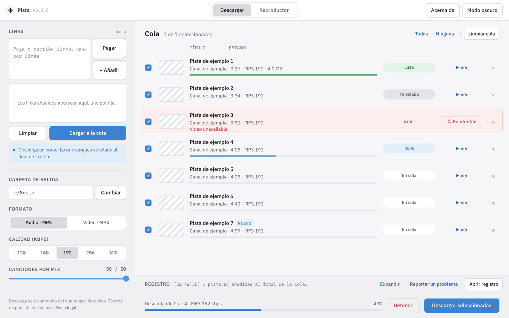
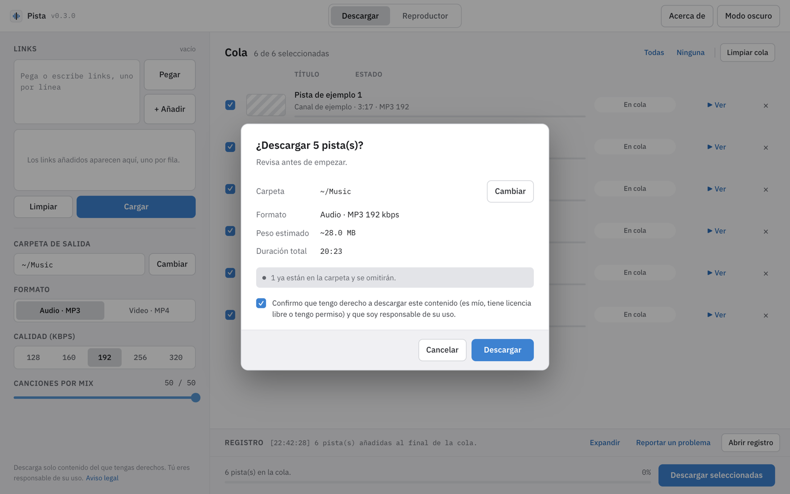
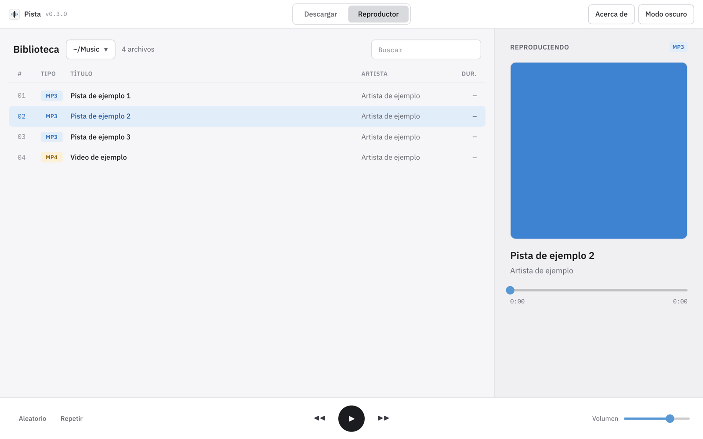

<p align="center">
  
</p>

<h1 align="center">Pista</h1>

<p align="center"><strong>Descarga audio y video, y reprodúcelos desde tu carpeta.</strong></p>

<p align="center">
  <a href="https://github.com/JySa65/pista-downloader/releases/latest"></a>
  <a href="LICENSE"></a>
  <a href="https://github.com/JySa65/pista-downloader/actions/workflows/release.yml"></a>
</p>

Pista es una aplicación de escritorio libre y gratuita para **Windows, macOS y Linux**. Descarga videos, listas y Mixes de YouTube como **MP3 o MP4** usando [yt-dlp](https://github.com/yt-dlp/yt-dlp), e incluye un reproductor para lo que descargaste. Los instaladores traen todo lo necesario (ffmpeg y un entorno de JavaScript): no hay que instalar nada más.

*Pista is a free, open-source desktop app (Windows, macOS, Linux) that downloads videos, playlists and Mixes as MP3 or MP4 with yt-dlp, with a built-in player. See the [legal notice](#aviso-legal--legal-notice).*



## Qué hace

- **Video, lista o Mix.** Pega uno o varios links: Pista detecta si es un video, una lista o un Mix y, en los Mix, pregunta si quieres solo ese video o el Mix completo (hasta 50 pistas).
- **MP3 o MP4** con la calidad que elijas: 128–320 kbps para audio, 360p a 4K para video.
- **Cola en vivo.** Puedes seguir cargando links mientras descarga: lo nuevo se añade al final («Nuevo»). Quita filas con ×, marca o desmarca, y limpia lo terminado.
- **Antes de empezar** te muestra cuántas pistas, el peso estimado, la duración y lo que se omitirá porque ya está descargado.
- **Reintentos.** Lo que falla se reintenta solo una vez y luego puedes usar «↻ Reintentar» en su fila. Lo ya descargado se omite la próxima vez.
- **Resumen** al terminar: descargadas, ya estaban, fallidas (con el motivo), detenidas, peso y tiempo, con accesos a la carpeta y al reproductor.
- **Reproductor** para tu carpeta: MP3 con su portada (se guarda al descargar) y MP4 con video y pantalla completa.
- **Registro y reportes.** Un registro completo para diagnosticar problemas y un botón «Reportar un problema» que abre el formulario de GitHub con tu versión y sistema.

| Confirmar descarga | Reproductor |
|---|---|
|  |  |

## Descargar e instalar

Descarga el instalador de tu sistema desde **[Releases](https://github.com/JySa65/pista-downloader/releases/latest)**.

| Sistema | Archivo | Cómo instalar |
|---|---|---|
| **Windows 10 y 11** (64 bits) | `Pista-Setup-<versión>.exe` | Ábrelo y sigue el asistente (menú Inicio, acceso directo opcional, se desinstala desde *Configuración → Aplicaciones*). Pista usa Microsoft Edge WebView2: Windows 11 ya lo trae y en Windows 10 el instalador lo instala si falta (necesita internet esa vez). Como el instalador no está firmado, SmartScreen puede avisar: *Más información → Ejecutar de todas formas*. |
| **macOS** (Apple Silicon) | `Pista-<versión>-macos-arm64.dmg` | Abre el .dmg y arrastra **Pista** a *Aplicaciones*. La app no está firmada: la primera vez, **clic derecho → Abrir → Abrir** (o *Ajustes del Sistema → Privacidad y seguridad → Abrir igualmente*). |
| **Linux** (x86_64, glibc 2.35+) | `Pista-<versión>-x86_64.AppImage` | `chmod +x Pista-*.AppImage` y ejecútalo. Necesita un escritorio X11/Wayland con las bibliotecas habituales (`libnss3`, `libxkbcommon-x11-0`, `libxcb-cursor0`). Si no arranca, instala `libfuse2` o ejecútalo con `--appimage-extract-and-run`. |

> **¿Venías de «YouTube → MP3» (v0.2.x)?** Pista es la misma app con otro nombre. En Windows el instalador reemplaza la versión anterior. En macOS, borra la app antigua «YouTubeDownload». Tus descargas no se tocan, y el registro y la caché pasan solos a la carpeta nueva.

## Uso rápido

1. **Links:** pega uno o varios (uno por línea) y pulsa **+ Añadir** (o Ctrl/⌘+Enter). **Pegar** los toma directo del portapapeles.
2. **Cargar:** las pistas aparecen en la **Cola** (todavía no se descarga nada). Si es un Mix, elige «Solo este video» o «Mix completo».
3. Elige la **carpeta de salida**, el **formato** (Audio · MP3 / Video · MP4) y la **calidad**.
4. **Descargar seleccionadas** → revisa el resumen previo, confirma que tienes derecho a descargar ese contenido y pulsa **Descargar**.
5. Al terminar, **Ir al reproductor** abre la pestaña **Reproductor** con lo descargado.

Las listas y los Mix se guardan en una subcarpeta con su nombre. **▶ Ver** muestra el video dentro de la app; si no carga, «¿No carga? Ver clip de 30 s» descarga una vista previa corta.

## Preguntas frecuentes

**Algunas descargas fallan con «HTTP Error 403: Forbidden».**
YouTube cambia a menudo y las versiones antiguas de yt-dlp dejan de funcionar. Actualiza a la [última versión de Pista](https://github.com/JySa65/pista-downloader/releases/latest) (**Acerca de → Buscar actualizaciones**). Si sigue pasando, usa **Reportar un problema** y adjunta el registro.

**¿Dónde está el registro?**
En la app: **Abrir registro → Mostrar en Finder / en el Explorador / en la carpeta**. El archivo es `pista.log`:

- Windows: `%LOCALAPPDATA%\pista\Cache\logs\pista.log`
- macOS: `~/Library/Caches/pista/logs/pista.log`
- Linux: `~/.cache/pista/logs/pista.log`

Tu carpeta personal aparece como `~`, así que no muestra tu nombre de usuario. Los links sí se ven: borra los privados antes de compartirlo.

**¿Por qué se omiten algunas pistas («Ya estaba»)?**
Pista anota lo que ya descargó en `.downloaded-audio.txt` y `.downloaded-video.txt`, dentro de la carpeta de salida (uno por formato), y no lo vuelve a bajar. Para descargar algo otra vez, borra su línea de ese archivo.

**¿Qué carpeta usa por defecto?**
`~/Music` (Música), o `~/Downloads` si no existe, o tu carpeta personal.

## Aviso legal / Legal notice

**ES —** Pista es una herramienta para uso personal y se ofrece «tal cual», sin garantías. Cada usuario es responsable de cumplir los [Términos de servicio de YouTube](https://www.youtube.com/t/terms) y las leyes de derechos de autor de su país. Descarga solo contenido sobre el que tengas derechos o permiso (por ejemplo, tus propios videos o material con licencia libre). Pista no está afiliada, asociada, respaldada ni patrocinada por YouTube ni por Google LLC; «YouTube» es una marca de Google LLC y se menciona solo para indicar con qué sitio funciona la aplicación.

**EN —** Pista is a tool for personal use, provided "as is", without warranty. Users are responsible for complying with [YouTube's Terms of Service](https://www.youtube.com/t/terms) and the copyright laws of their country. Only download content you own or have permission to download (for example your own uploads or openly licensed material). Pista is not affiliated with, associated with, endorsed or sponsored by YouTube or Google LLC; "YouTube" is a trademark of Google LLC and is used only to describe which site the app works with.

## Desarrollo

```sh
uv sync
uv run main.py        # ventana nativa (o --browser)
uv run pytest -q
```

Necesitas [uv](https://docs.astral.sh/uv/) y `ffmpeg` en el `PATH`. Configuración por sistema, estructura del proyecto, convenciones y cómo se publican las versiones: **[CONTRIBUTING.md](.github/CONTRIBUTING.md)**. Código de conducta: [CODE_OF_CONDUCT.md](.github/CODE_OF_CONDUCT.md). Seguridad: [SECURITY.md](.github/SECURITY.md).

## Licencia

© 2026 jysa65. Pista es software libre: puedes redistribuirlo y modificarlo bajo los términos de la [GNU General Public License v3.0 o posterior](LICENSE), sin ninguna garantía.

Los instaladores incluyen componentes de terceros con sus propias licencias (yt-dlp, FFmpeg LGPL, Deno, NiceGUI, …): ver [THIRD_PARTY_NOTICES.md](.github/THIRD_PARTY_NOTICES.md).

## Autor

**jysa65** · [github.com/JySa65](https://github.com/JySa65) · [jysa65.dev](https://jysa65.dev/es/)
